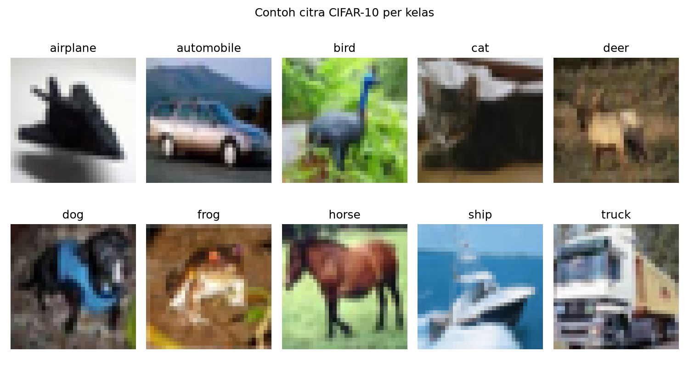
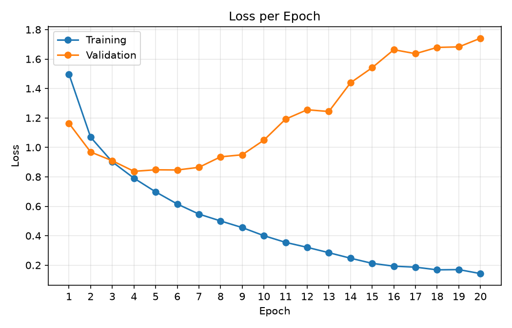
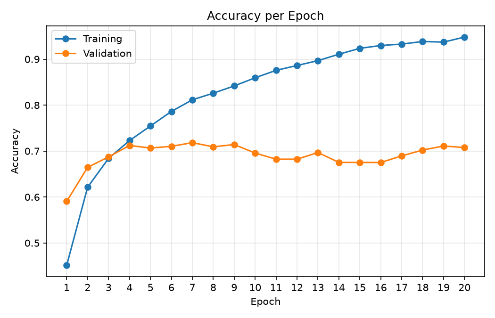
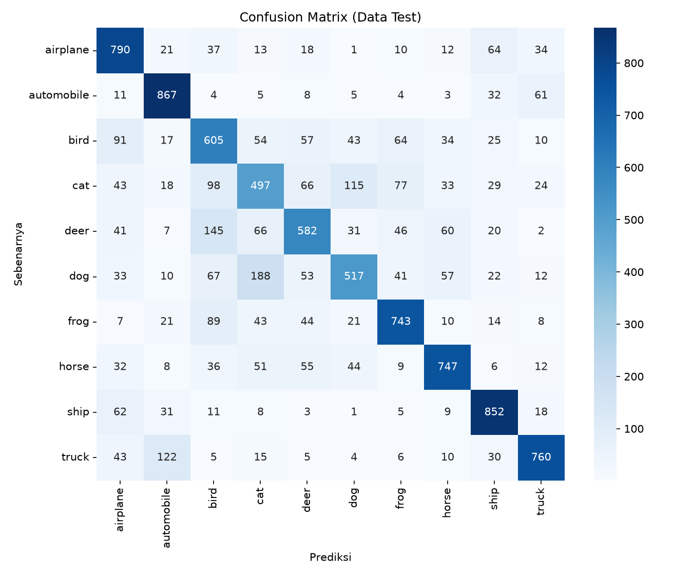

# Klasifikasi Citra CIFAR-10 Menggunakan Convolutional Neural Network

**Laporan Projek Ujian Tengah Semester**
**Mata Kuliah:** Advanced Computer Vision (03MKMM002)
**Dosen:** Dr. Kahfi H Suradiradja, M.Kom

**Nama:** Yudi Saeful Rizal
**NIM:** 251012000151
**Program Studi:** Teknik Informatika S-2, Fakultas Ilmu Komputer, Universitas Pamulang
**Tahun Akademik:** 2026/2027

---

## 1. Pendahuluan

### 1.1 Latar Belakang

Klasifikasi citra adalah salah satu masalah dasar dalam *computer vision*, yaitu menentukan kelas dari sebuah citra masukan berdasarkan isi visualnya. Pendekatan klasik membutuhkan fitur yang dirancang manual (misalnya tepi, tekstur, atau histogram warna) sebelum diberikan ke pengklasifikasi, sehingga kualitas hasil sangat bergantung pada keahlian perancangnya dan sulit menangani variasi pose, pencahayaan, dan latar belakang.

*Convolutional Neural Network* (CNN) mengatasi keterbatasan ini dengan mempelajari fitur secara otomatis langsung dari piksel (LeCun et al., 1998). Lapisan konvolusi menerapkan filter kecil yang dipelajari ke seluruh citra sehingga mampu mendeteksi pola lokal seperti tepi dan tekstur, dengan jumlah parameter yang jauh lebih sedikit dibanding jaringan *fully-connected* karena bobot filter dipakai bersama di seluruh posisi. Lapisan *pooling* memperkecil ukuran peta fitur sehingga representasi menjadi lebih ringkas dan lebih toleran terhadap pergeseran posisi objek. Tumpukan lapisan tersebut membentuk hierarki fitur, dari pola sederhana di lapisan awal sampai bagian objek di lapisan yang lebih dalam, yang kemudian diklasifikasikan oleh lapisan *fully-connected*.

### 1.2 Tujuan

Tujuan proyek ini adalah membangun model CNN sederhana untuk mengklasifikasikan citra pada dataset CIFAR-10 ke dalam 10 kelas, kemudian mengevaluasi performanya pada data uji menggunakan metrik Accuracy, Precision, Recall, F1-Score, dan *confusion matrix*, serta menganalisis ada tidaknya *overfitting* dan pola kesalahan klasifikasinya.

### 1.3 Dataset

Dataset yang digunakan adalah **CIFAR-10** (Krizhevsky, 2009), dataset publik yang banyak dipakai sebagai tolok ukur klasifikasi citra. Dataset berisi 60.000 citra berwarna (RGB) berukuran **32×32 piksel** dalam **10 kelas** yang saling lepas: *airplane*, *automobile*, *bird*, *cat*, *deer*, *dog*, *frog*, *horse*, *ship*, dan *truck*. Setiap kelas memiliki jumlah citra yang sama sehingga dataset seimbang. Dataset diunduh dari https://www.cs.toronto.edu/~kriz/cifar.html.

**Tabel 1. Pembagian data**

| Bagian | Jumlah citra | Per kelas | Keterangan |
|--------|-------------:|----------:|------------|
| Data train | 40.000 | 4.000 | 80% dari data train asli, untuk memperbarui bobot |
| Data validasi | 10.000 | 1.000 | 20% dari data train asli, untuk memantau generalisasi |
| Data test | 10.000 | 1.000 | data uji resmi, tidak dipakai selama pelatihan |
| **Total** | **60.000** | | |

*Catatan:* pembagian 80:20 dilakukan dengan `train_test_split` (acak, `stratify` per kelas, `random_state=42`) sehingga setiap kelas tetap seimbang pada data train (4.000) dan data validasi (1.000).



**Gambar 1.** Contoh satu citra untuk setiap kelas CIFAR-10. Pada resolusi 32×32, detail objek sangat terbatas.

---

## 2. Metodologi

### 2.1 Pra-Pemrosesan

Pra-pemrosesan terdiri dari dua langkah:

1. **Normalisasi piksel.** Nilai piksel asli bertipe `uint8` dengan rentang 0–255. Seluruh nilai diubah ke `float32` lalu dibagi 255,0 sehingga berada pada rentang 0–1. Hasilnya diverifikasi: nilai minimum 0,0 dan maksimum 1,0 baik pada data train maupun data test. Skala masukan yang kecil dan seragam menjaga besar aktivasi dan gradien tetap stabil sehingga proses optimisasi lebih cepat dan tidak mudah diverge.
2. **One-hot encoding label.** Label integer 0–9 diubah menjadi vektor biner berdimensi 10 (misalnya kelas 0, *airplane*, menjadi `[1,0,0,0,0,0,0,0,0,0]`) agar sesuai dengan fungsi loss *categorical crossentropy*.

Tidak ada augmentasi data yang digunakan, sehingga model ini menjadi *baseline* murni.

### 2.2 Arsitektur Model

Model dibangun dengan `keras.Sequential`, terdiri dari tiga blok konvolusi-*pooling*, satu lapisan *Flatten*, satu lapisan *Dense* tersembunyi, dan satu lapisan *Dense* keluaran. Seluruh bobot diinisialisasi acak (tidak memakai bobot *pretrained*).

**Tabel 2. Arsitektur model (ringkasan `model.summary()`)**

| No | Layer | Konfigurasi | Output Shape | Parameter |
|---:|-------|-------------|--------------|----------:|
| 1 | Conv2D | 32 filter, 3×3, ReLU, padding *same* | (32, 32, 32) | 896 |
| 2 | MaxPooling2D | 2×2 | (16, 16, 32) | 0 |
| 3 | Conv2D | 64 filter, 3×3, ReLU, padding *same* | (16, 16, 64) | 18.496 |
| 4 | MaxPooling2D | 2×2 | (8, 8, 64) | 0 |
| 5 | Conv2D | 128 filter, 3×3, ReLU, padding *same* | (8, 8, 128) | 73.856 |
| 6 | MaxPooling2D | 2×2 | (4, 4, 128) | 0 |
| 7 | Flatten | | (2.048) | 0 |
| 8 | Dense | 128 unit, ReLU | (128) | 262.272 |
| 9 | Dense | 10 unit, Softmax | (10) | 1.290 |
| | **Total parameter** | | | **356.810** (1,36 MB) |

Seluruh parameter (356.810) dapat dilatih; tidak ada parameter *non-trainable*.

**Pemilihan fungsi aktivasi:**

- **ReLU** pada semua lapisan tersembunyi (konvolusi dan *Dense* 128). ReLU, yaitu *f(x) = max(0, x)*, menambahkan non-linearitas yang diperlukan agar jaringan dapat mempelajari pola kompleks, murah dihitung, dan tidak mengalami saturasi pada nilai positif sehingga mengurangi masalah *vanishing gradient* dibanding sigmoid atau tanh (Nair & Hinton, 2010).
- **Softmax** pada lapisan keluaran. Softmax mengubah 10 nilai keluaran menjadi distribusi probabilitas yang jumlahnya 1, sehingga sesuai untuk klasifikasi multi-kelas dengan satu label benar dan dapat dipasangkan dengan *categorical crossentropy*.

Jumlah filter digandakan di setiap blok (32, 64, 128) sementara resolusi spasial dibagi dua oleh *pooling*, sehingga lapisan awal menangkap fitur sederhana pada resolusi tinggi dan lapisan yang lebih dalam menangkap fitur lebih abstrak pada resolusi rendah.

### 2.3 Parameter Pelatihan

**Tabel 3. Parameter pelatihan**

| Parameter | Nilai |
|-----------|-------|
| Optimizer | Adam (Kingma & Ba, 2015) |
| Learning rate | 0,001 |
| Loss function | Categorical Crossentropy |
| Metrik | Accuracy |
| Batch size | 64 |
| Jumlah epoch | 20 |
| Validasi | 20% dari data train (`train_test_split`, stratified) |
| Seed acak | 42 |
| Perangkat | CPU (TensorFlow 2.21) |

Waktu pelatihan sekitar 30 detik per epoch (sekitar 10 menit untuk 20 epoch). Riwayat loss dan accuracy per epoch disimpan ke `hasil/history.csv`.

---

## 3. Hasil dan Analisis

### 3.1 Kurva Pelatihan



**Gambar 2.** Grafik *loss* data training vs validation per epoch.



**Gambar 3.** Grafik *accuracy* data training vs validation per epoch.

**Tabel 4. Cuplikan riwayat pelatihan (nilai training adalah rata-rata selama epoch berjalan; cetak tebal = val loss terendah dan val accuracy tertinggi)**

| Epoch | Train loss | Train acc | Val loss | Val acc |
|------:|-----------:|----------:|---------:|--------:|
| 1 | 1,4972 | 0,4515 | 1,1634 | 0,5905 |
| 3 | 0,9017 | 0,6841 | 0,9094 | 0,6873 |
| 4 | 0,7909 | 0,7228 | **0,8375** | 0,7121 |
| 7 | 0,5471 | 0,8116 | 0,8645 | **0,7183** |
| 10 | 0,4003 | 0,8595 | 1,0492 | 0,6957 |
| 15 | 0,2124 | 0,9236 | 1,5414 | 0,6753 |
| 20 | 0,1428 | 0,9481 | 1,7412 | 0,7077 |

### 3.2 Metrik Performa pada Data Test

Evaluasi menggunakan model akhir (setelah epoch ke-20) pada 10.000 citra test.

- **Test loss:** 1,7789
- **Test accuracy:** 0,6960 (69,60%)

**Tabel 5. Precision, Recall, dan F1-Score per kelas (data test)**

| Kelas | Precision | Recall | F1-Score | Support |
|-------|----------:|-------:|---------:|--------:|
| airplane | 0,6852 | 0,7900 | 0,7339 | 1.000 |
| automobile | 0,7727 | 0,8670 | 0,8172 | 1.000 |
| bird | 0,5515 | 0,6050 | 0,5770 | 1.000 |
| cat | 0,5287 | 0,4970 | 0,5124 | 1.000 |
| deer | 0,6532 | 0,5820 | 0,6155 | 1.000 |
| dog | 0,6611 | 0,5170 | 0,5802 | 1.000 |
| frog | 0,7393 | 0,7430 | 0,7411 | 1.000 |
| horse | 0,7662 | 0,7470 | 0,7565 | 1.000 |
| ship | 0,7788 | 0,8520 | 0,8138 | 1.000 |
| truck | 0,8077 | 0,7600 | 0,7831 | 1.000 |
| **Accuracy** | | | **0,6960** | 10.000 |
| **Macro avg** | 0,6944 | 0,6960 | 0,6931 | 10.000 |
| **Weighted avg** | 0,6944 | 0,6960 | 0,6931 | 10.000 |

Karena setiap kelas memiliki 1.000 citra test, rata-rata *macro* dan *weighted* bernilai sama. Kelas dengan F1-Score tertinggi adalah *automobile* (0,8172) dan *ship* (0,8138), sedangkan yang terendah adalah *cat* (0,5124), *bird* (0,5770), dan *dog* (0,5802).

### 3.3 Confusion Matrix



**Gambar 4.** *Confusion matrix* pada data test (baris = kelas sebenarnya, kolom = kelas prediksi).

### 3.4 Analisis Kinerja

#### 3.4.1 Analisis Overfitting

**Model mengalami overfitting yang jelas.** Buktinya dari kurva pelatihan:

- **Val loss mencapai titik terendah di epoch 4 (0,8375), lalu cenderung naik** sampai 1,7412 di epoch 20, sekitar dua kali lipat nilai terbaiknya (2,08 kali). Pada periode yang sama train loss justru terus turun dari 0,7909 (epoch 4) menjadi 0,1428. Kurva training dan validation relatif berdekatan sampai epoch 4, lalu berpisah dan jaraknya terus melebar.
- **Train accuracy terus naik sampai 94,81% di epoch 20, tetapi val accuracy berhenti di kisaran 67–72% sejak epoch 4.** Val accuracy tertinggi hanya 71,83% (epoch 7), sempat turun ke 67,51% (epoch 16), dan berakhir di 70,77% (epoch 20). Selisih akurasi training dan validasi di epoch terakhir sekitar 24 poin persentase (94,81% vs 70,77%).
- Accuracy pada data test (69,60%) berdekatan dengan val accuracy akhir (70,77%, selisih sekitar 1 poin), sehingga angka validasi merupakan perkiraan yang masuk akal untuk performa pada data baru. Model tidak mampu melampaui sekitar 72% meskipun akurasi training mendekati 95%.

**Penyebab.** Model memiliki kapasitas yang besar relatif terhadap data: 356.810 parameter, dengan 262.272 di antaranya (sekitar 73,5%) berada di lapisan *Dense* 128 setelah *Flatten*, sedangkan data train efektif hanya 40.000 citra kecil. Tanpa *regularization* (tidak ada *Dropout*, *weight decay*, maupun augmentasi data) dan dilatih selama 20 epoch tanpa *early stopping*, model mulai menghafal detail dan derau spesifik data train setelah epoch 4 alih-alih mempelajari fitur yang umum. Hal ini terlihat dari loss validasi yang membesar: model menjadi semakin yakin pada prediksi yang salah. Titik model terbaik secara generalisasi (val loss terendah) berada di sekitar epoch 4, sedangkan model akhir yang dievaluasi adalah model epoch 20.

#### 3.4.2 Analisis Kesalahan

Berdasarkan *confusion matrix*, kesalahan terbanyak (kelas sebenarnya → prediksi) adalah:

**Tabel 6. Lima pasangan kesalahan terbanyak pada data test**

| Peringkat | Sebenarnya → Prediksi | Jumlah citra | Persentase dari kelas |
|----------:|-----------------------|-------------:|----------------------:|
| 1 | dog → cat | 188 | 18,8% |
| 2 | deer → bird | 145 | 14,5% |
| 3 | truck → automobile | 122 | 12,2% |
| 4 | cat → dog | 115 | 11,5% |
| 5 | cat → bird | 98 | 9,8% |

**Kelas yang paling bermasalah adalah *cat*, yang sering tertukar dengan *dog*.** Sebanyak 188 citra anjing diprediksi kucing dan 115 citra kucing diprediksi anjing, total 303 kesalahan antar kedua kelas. *Cat* menjadi kelas terburuk (recall 49,7%, precision 52,9%, F1 0,5124) dan *dog* menyusul dengan recall 51,7%. Kesalahan *cat* juga tersebar ke kelas lain (*bird* 98, *frog* 77, *deer* 66), menandakan model belum menemukan ciri pembeda yang kuat untuk kucing. Penyebabnya menurut analisis ini: keduanya hewan berbulu berkaki empat dengan ukuran tubuh, bentuk kepala, dan warna yang mirip; pada resolusi 32×32 ciri pembeda halus seperti bentuk telinga, moncong, dan tekstur bulu hampir hilang; dan keduanya muncul dengan pose serta latar yang sangat beragam (misalnya di dalam ruangan atau di atas rumput) sehingga variasi dalam kelas besar sementara batas antar kelas tipis.

**Kelas *bird* menjadi "penampung" kesalahan hewan lain.** Prediksi *bird* menerima 145 citra *deer*, 98 citra *cat*, 89 citra *frog*, dan 67 citra *dog*, sehingga precision *bird* hanya 55,2% (terendah kedua setelah *cat*). Kemungkinan penyebabnya, *bird* adalah kelas dengan variasi penampilan terbesar (banyak jenis, ukuran, dan pose) dan objeknya kecil di tengah latar alam berwarna hijau atau cokelat, yang juga menjadi latar *deer* dan *frog*. Pada resolusi 32×32, model tampak mengandalkan warna dan latar sehingga hewan di latar alam mudah dianggap burung.

**Kelas kendaraan lebih mudah dikenali.** *Automobile* (F1 0,8172), *ship* (0,8138), dan *truck* (0,7831) memiliki F1 tertinggi, kemungkinan karena objek buatan manusia berbentuk kaku dengan siluet yang lebih konsisten. Kesalahan terbesar di kelompok ini bersifat tidak simetris: *truck → automobile* 122 citra (12,2%) jauh lebih banyak daripada *automobile → truck* 61 citra (6,1%), kemungkinan karena kendaraan besar seperti *pickup* atau *van* secara visual berada di antara kedua kelas dan model cenderung memilih kelas *automobile*. Kesalahan antar kendaraan juga terlihat pada *airplane → ship* (64 citra) dan *ship → airplane* (62 citra), yang kemungkinan disebabkan latar langit atau laut berwarna biru yang mirip sehingga model terpengaruh warna latar. Kesalahan ini sejalan dengan keterbatasan model yang sederhana, yaitu hanya tiga lapisan konvolusi dan tanpa augmentasi, sehingga belum cukup kuat membedakan objek yang mirip.

---

## 4. Kesimpulan

**Temuan utama.**

1. CNN sederhana (3 blok Conv2D + MaxPooling2D, 356.810 parameter) mencapai **akurasi 69,60%** pada data test CIFAR-10 dengan macro F1-Score 0,6931, jauh di atas tebakan acak (10%).
2. Model **mengalami overfitting**: accuracy training naik sampai 94,81% sedangkan accuracy validasi tertahan di sekitar 67–72% sejak epoch 4, dan val loss naik dari 0,8375 (epoch 4) menjadi 1,7412 (epoch 20). Selisih akurasi training dan validasi sekitar 24 poin persentase.
3. Kelas yang paling mudah dikenali adalah *automobile* dan *ship* (F1 sekitar 0,82), sedangkan yang tersulit adalah *cat* (F1 0,51). Kesalahan paling sering terjadi antara *cat* dan *dog* (303 citra), dan kelas *bird* banyak menampung salah prediksi hewan lain (misalnya 145 citra *deer*), yang dijelaskan oleh kemiripan bentuk, warna, dan latar pada resolusi 32×32.

**Saran perbaikan.**

1. **Menambahkan *Data Augmentation*** (misalnya *horizontal flip*, rotasi kecil, dan pergeseran/*zoom* acak). Augmentasi memperbanyak variasi data train secara efektif sehingga mengurangi kecenderungan model menghafal, dan membantu terutama kelas hewan yang bervariasi pose dan latarnya.
2. **Menggunakan *Dropout*** (misalnya 0,5 setelah lapisan *Dense* 128) dan *early stopping* berdasarkan val loss. *Dropout* mengurangi ketergantungan pada neuron tertentu pada lapisan *Dense* yang menyimpan sebagian besar parameter, sedangkan *early stopping* (dengan `restore_best_weights`) menghentikan pelatihan setelah val loss berhenti membaik dan memakai bobot dari epoch terbaiknya, yang pada konfigurasi ini berada di sekitar epoch 4.

---

## 5. Lampiran

### 5.1 Daftar Pustaka

- Krizhevsky, A. (2009). *Learning Multiple Layers of Features from Tiny Images*. Technical Report, University of Toronto. https://www.cs.toronto.edu/~kriz/cifar.html
- LeCun, Y., Bottou, L., Bengio, Y., & Haffner, P. (1998). Gradient-based learning applied to document recognition. *Proceedings of the IEEE*, 86(11), 2278–2324. https://doi.org/10.1109/5.726791
- Nair, V., & Hinton, G. E. (2010). Rectified linear units improve restricted Boltzmann machines. *Proceedings of the 27th International Conference on Machine Learning (ICML)*, 807–814.
- Kingma, D. P., & Ba, J. (2015). Adam: A method for stochastic optimization. *International Conference on Learning Representations (ICLR)*. arXiv:1412.6980

### 5.2 Kode Sumber

Kode lengkap tersedia pada berkas `uts_acv_cnn.ipynb`. Berikut isi seluruh sel kode.

```python
import os
os.environ["TF_CPP_MIN_LOG_LEVEL"] = "2"  # sembunyikan log info TensorFlow

from pathlib import Path

import numpy as np
import pandas as pd
import matplotlib.pyplot as plt
import seaborn as sns
import tensorflow as tf
from PIL import Image
from tensorflow import keras
from tensorflow.keras import layers
from sklearn.metrics import classification_report, confusion_matrix
from sklearn.model_selection import train_test_split

# Seed agar hasil dapat direproduksi (angka di laporan = angka di notebook)
SEED = 42
keras.utils.set_random_seed(SEED)

DATA_DIR = Path("data/cifar-10-images")      # folder gambar: train/<kelas>/*.png dan test/<kelas>/*.png
HASIL_DIR = Path("hasil")                     # tempat menyimpan grafik, history, dan model
HASIL_DIR.mkdir(exist_ok=True)

print("TensorFlow", tf.__version__)
```

```python
# Nama kelas = nama folder (urut abjad)
NAMA_KELAS = sorted(p.name for p in (DATA_DIR / "train").iterdir() if p.is_dir())
NUM_KELAS = len(NAMA_KELAS)

def muat_folder(folder):
    """Membaca semua gambar di folder/<kelas>/*.png, mengembalikan citra (N, 32, 32, 3) dan label (N,)."""
    x, y = [], []
    for label, kelas in enumerate(NAMA_KELAS):
        for file in sorted((folder / kelas).glob("*.png")):
            x.append(np.array(Image.open(file).convert("RGB")))
            y.append(label)
    return np.array(x), np.array(y)

x_train, y_train = muat_folder(DATA_DIR / "train")  # data train
x_test, y_test = muat_folder(DATA_DIR / "test")     # data test

print("x_train:", x_train.shape, "| y_train:", y_train.shape)
print("x_test :", x_test.shape, "| y_test :", y_test.shape)
print("Kelas  :", NAMA_KELAS)
print("Jumlah per kelas (train):", np.bincount(y_train))
print("Jumlah per kelas (test) :", np.bincount(y_test))
```

```python
# Tampilkan satu contoh citra untuk setiap kelas
fig, axes = plt.subplots(2, 5, figsize=(10, 5.6))
for k, ax in enumerate(axes.flat):
    idx = np.where(y_train == k)[0][0]
    ax.imshow(x_train[idx])
    ax.set_title(NAMA_KELAS[k])
    ax.axis("off")
plt.suptitle("Contoh citra CIFAR-10 per kelas")
plt.tight_layout(h_pad=2.0)
plt.savefig(HASIL_DIR / "contoh_dataset.png", dpi=150)
plt.show()
```

```python
# Normalisasi piksel ke rentang 0-1
x_train = x_train.astype("float32") / 255.0
x_test = x_test.astype("float32") / 255.0
print(f"Rentang x_train: {x_train.min():.1f} - {x_train.max():.1f}")
print(f"Rentang x_test : {x_test.min():.1f} - {x_test.max():.1f}")

# One-hot encoding label
y_train_oh = keras.utils.to_categorical(y_train, NUM_KELAS)
y_test_oh = keras.utils.to_categorical(y_test, NUM_KELAS)
print("Contoh label", y_train[0], "->", y_train_oh[0])
```

```python
model = keras.Sequential([
    keras.Input(shape=(32, 32, 3)),

    # Blok konvolusi 1
    layers.Conv2D(32, (3, 3), activation="relu", padding="same"),
    layers.MaxPooling2D((2, 2)),

    # Blok konvolusi 2
    layers.Conv2D(64, (3, 3), activation="relu", padding="same"),
    layers.MaxPooling2D((2, 2)),

    # Blok konvolusi 3
    layers.Conv2D(128, (3, 3), activation="relu", padding="same"),
    layers.MaxPooling2D((2, 2)),

    # Klasifikasi
    layers.Flatten(),
    layers.Dense(128, activation="relu"),
    layers.Dense(NUM_KELAS, activation="softmax"),
], name="cnn_cifar10")

model.summary()
```

```python
LEARNING_RATE = 0.001

model.compile(
    optimizer=keras.optimizers.Adam(learning_rate=LEARNING_RATE),
    loss="categorical_crossentropy",
    metrics=["accuracy"],
)
```

```python
EPOCHS = 20
BATCH_SIZE = 64

# Pisahkan 20% data train sebagai data validasi (acak, jumlah per kelas merata)
x_tr, x_val, y_tr, y_val = train_test_split(
    x_train, y_train_oh, test_size=0.2, stratify=y_train, random_state=SEED)
print("Train:", x_tr.shape, "| Validasi:", x_val.shape)

history = model.fit(
    x_tr, y_tr,
    validation_data=(x_val, y_val),
    epochs=EPOCHS,
    batch_size=BATCH_SIZE,
    verbose=2,
)

# Simpan riwayat pelatihan
hist = pd.DataFrame(history.history)
hist.index = range(1, len(hist) + 1)
hist.index.name = "epoch"
hist.to_csv(HASIL_DIR / "history.csv")
model.save(HASIL_DIR / "model_cnn.keras")
hist.round(4)
```

```python
# Grafik Loss: training vs validation
plt.figure(figsize=(7, 4.5))
plt.plot(hist.index, hist["loss"], marker="o", label="Training")
plt.plot(hist.index, hist["val_loss"], marker="o", label="Validation")
plt.title("Loss per Epoch")
plt.xlabel("Epoch")
plt.ylabel("Loss")
plt.xticks(hist.index)
plt.legend()
plt.grid(alpha=0.3)
plt.tight_layout()
plt.savefig(HASIL_DIR / "loss_curve.png", dpi=150)
plt.show()

# Grafik Accuracy: training vs validation
plt.figure(figsize=(7, 4.5))
plt.plot(hist.index, hist["accuracy"], marker="o", label="Training")
plt.plot(hist.index, hist["val_accuracy"], marker="o", label="Validation")
plt.title("Accuracy per Epoch")
plt.xlabel("Epoch")
plt.ylabel("Accuracy")
plt.xticks(hist.index)
plt.legend()
plt.grid(alpha=0.3)
plt.tight_layout()
plt.savefig(HASIL_DIR / "accuracy_curve.png", dpi=150)
plt.show()
```

```python
# Ringkasan angka untuk analisis overfitting
ep_best = int(hist["val_loss"].idxmin())
print(f"Val loss terendah   : {hist['val_loss'].min():.4f} pada epoch {ep_best}")
print(f"Val accuracy terbaik: {hist['val_accuracy'].max():.4f} pada epoch {int(hist['val_accuracy'].idxmax())}")
print(f"Epoch terakhir ({EPOCHS}): train acc {hist['accuracy'].iloc[-1]:.4f}, val acc {hist['val_accuracy'].iloc[-1]:.4f}, "
      f"train loss {hist['loss'].iloc[-1]:.4f}, val loss {hist['val_loss'].iloc[-1]:.4f}")
print(f"Selisih accuracy train - val di epoch terakhir: {hist['accuracy'].iloc[-1] - hist['val_accuracy'].iloc[-1]:.4f}")
```

```python
test_loss, test_acc = model.evaluate(x_test, y_test_oh, verbose=0)
print(f"Test loss    : {test_loss:.4f}")
print(f"Test accuracy: {test_acc:.4f}")

# Prediksi kelas = indeks probabilitas tertinggi
y_pred = np.argmax(model.predict(x_test, verbose=0), axis=1)

laporan = classification_report(y_test, y_pred, target_names=NAMA_KELAS, digits=4)
print(laporan)
_ = (HASIL_DIR / "classification_report.txt").write_text(laporan)
```

```python
# Confusion matrix: baris = kelas sebenarnya, kolom = kelas prediksi
cm = confusion_matrix(y_test, y_pred)

plt.figure(figsize=(9, 7.5))
sns.heatmap(cm, annot=True, fmt="d", cmap="Blues",
            xticklabels=NAMA_KELAS, yticklabels=NAMA_KELAS)
plt.title("Confusion Matrix (Data Test)")
plt.xlabel("Prediksi")
plt.ylabel("Sebenarnya")
plt.tight_layout()
plt.savefig(HASIL_DIR / "confusion_matrix.png", dpi=150)
plt.show()
```

```python
# Pasangan kelas yang paling sering tertukar (nilai di luar diagonal terbesar)
salah = [(cm[i, j], NAMA_KELAS[i], NAMA_KELAS[j])
         for i in range(NUM_KELAS) for j in range(NUM_KELAS) if i != j]
print("5 kesalahan klasifikasi terbanyak (sebenarnya -> prediksi):")
for n, asli, pred in sorted(salah, reverse=True)[:5]:
    print(f"  {asli:>10} -> {pred:<10}: {n} citra")

# Akurasi per kelas (recall) untuk melihat kelas terbaik dan terburuk
akurasi_kelas = cm.diagonal() / cm.sum(axis=1)
for k in np.argsort(akurasi_kelas):
    print(f"  {NAMA_KELAS[k]:>10}: {akurasi_kelas[k]:.4f}")
```
